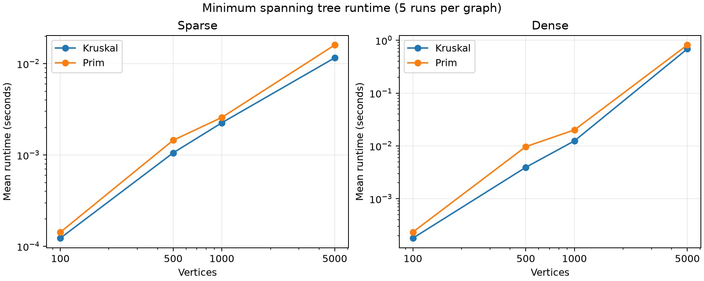

# Graph Algorithms Project 06
## Wiring a New Campus at the Lowest Cost

## About the Project

The goal is to connect all the buildings on a campus using as little cable as possible. We use **36 buildings at IIT Bombay** as our campus dataset.

Each building is a vertex, and each pair of buildings is a possible cable route. We use the Haversine distance between the two building coordinates as the edge weight in metres. The model assumes that cable cost is proportional to this direct distance.

## Tasks

### 1. Prim's Algorithm

- Build a weighted graph from the building coordinates.
- Find the minimum spanning tree (MST) using Prim's algorithm with a min-heap.
- Plot the selected cables as blue lines between building pins on a white background.

### 2. Kruskal's Algorithm

- Find the MST using Kruskal's algorithm and union–find.
- Check that the total cable length agrees with Prim's result.
- Compare runtimes on sparse and denser graphs built from seeded random points at **100, 500, 1,000, and 5,000 vertices**. Each reported time is the mean of **five runs**.

### 3. Network Constraints

- Test a mandatory cable, a forbidden cable, and a limit of three cables per building.
- Apply each rule separately and then apply all three together. Use a greedy approach for the scenarios with a degree limit.
- Compare each scenario's cable length with the unrestricted MST.

### 4. Spanning Tree Enumeration

- List and count every spanning tree for complete and ring graphs with **2–8 buildings**.
- Verify the counts using Kirchhoff's Matrix–Tree Theorem.
- Export the count comparison and the full list of layouts.

## Technologies Used

| Tool | Purpose |
|---|---|
| Python | Graph construction and algorithms |
| `heapq` | Min-heap for Prim's algorithm |
| `fractions.Fraction` | Exact arithmetic for the determinant in Task 4 |
| Folium | Interactive campus wiring visualization |
| Matplotlib | Runtime comparison plot |
| `unittest` and NetworkX | Hand-worked tests and independent checks |
| CSV | Building coordinates and tabular results |

## Project Structure

```text
Wiring-A-New-Campus-At-The-Lowest-Cost/
├── data/
│   ├── buildings.csv                # IIT Bombay coordinates used by Tasks 1–4
│   ├── buildings_template.csv       # CSV header for a new dataset
│   └── demo_buildings.csv            # Synthetic coordinates for the walkthrough
├── results/
│   ├── campus_mst_map.html           # Campus wiring visualization
│   ├── task2_benchmark.csv           # Mean runtimes
│   ├── task2_benchmark.png           # Runtime comparison plot
│   ├── task2_benchmark_machine.txt   # Benchmark machine and Python details
│   ├── task3_costs.csv               # Cable length by constraint
│   └── task4_results.csv             # Enumeration and Kirchhoff counts
├── .gitignore
├── README.md
├── requirements.txt
├── task1_prim_project.py             # Prim's MST and campus visualization
├── task2_kruskal.py                  # Kruskal's MST and timing comparison
├── task3_constraints.py              # Individual and combined wiring constraints
├── task4_spanning_trees.py           # Enumeration and Kirchhoff verification
└── test_campus_algorithms.py         # Hand-worked examples and NetworkX checks
```

## Input Data

[`data/buildings.csv`](data/buildings.csv) contains the names and coordinates of **36 buildings at IIT Bombay**. The coordinates come from the centroids of mapped building footprints inside the [IIT Bombay campus boundary](https://www.openstreetmap.org/relation/8546708). Data © [OpenStreetMap contributors](https://www.openstreetmap.org/copyright).

```csv
building,latitude,longitude
Nandan Nilekani Main Building,19.1329094,72.9152559
Central Library,19.1340744,72.9151056
```

All four task scripts read `data/buildings.csv`. [`data/demo_buildings.csv`](data/demo_buildings.csv) contains synthetic coordinates for the separate Prim and Kruskal walkthrough.

## How to Run

Run the commands from the repository folder. Run Task 1 before Task 2 so Task 2 can compare against the freshly saved Prim result. The scripts create a local `outputs/` folder automatically. The saved project results on GitHub are in `results/`.

### Windows PowerShell

```powershell
py -m venv .venv
.\.venv\Scripts\python.exe -m pip install -r requirements.txt
.\.venv\Scripts\python.exe -m unittest -v test_campus_algorithms

.\.venv\Scripts\python.exe task1_prim_project.py
.\.venv\Scripts\python.exe task2_kruskal.py
.\.venv\Scripts\python.exe task3_constraints.py
.\.venv\Scripts\python.exe task4_spanning_trees.py
```

### macOS, Linux, or WSL

```bash
python3 -m venv .venv
./.venv/bin/python -m pip install -r requirements.txt
./.venv/bin/python -m unittest -v test_campus_algorithms

./.venv/bin/python task1_prim_project.py
./.venv/bin/python task2_kruskal.py
./.venv/bin/python task3_constraints.py
./.venv/bin/python task4_spanning_trees.py
```

## Output Files

The [`results/`](results/) folder contains the following files from the project run.

| Task | File | Contents |
|---|---|---|
| 1 | [`campus_mst_map.html`](results/campus_mst_map.html) | Blue building pins and MST cables plotted at the IIT Bombay coordinates |
| 2 | [`task2_benchmark.csv`](results/task2_benchmark.csv) | Mean runtimes for Prim and Kruskal |
| 2 | [`task2_benchmark.png`](results/task2_benchmark.png) | Runtime comparison plot |
| 2 | [`task2_benchmark_machine.txt`](results/task2_benchmark_machine.txt) | Benchmark machine and Python details |
| 3 | [`task3_costs.csv`](results/task3_costs.csv) | Total and extra cable length for each scenario |
| 4 | [`task4_results.csv`](results/task4_results.csv) | Enumeration and Kirchhoff counts for each graph |

Download `campus_mst_map.html` and open it in a browser to view the interactive visualization. Running the scripts also generates the full cable lists, text summaries, and individual spanning-tree layouts locally.

## Results

- **Task 1:** Prim connected **36 buildings** with **35 cables** totaling **3,319.18 m**.
- **Task 2:** Kruskal matched Prim's MST length. Kruskal had the lower mean runtime in all **eight benchmark configurations** on the recorded machine. On the denser graph with **5,000 vertices and 625,000 edges**, Kruskal averaged **0.689 s** and Prim averaged **0.816 s**.
- **Task 3:** Requiring the Main Building–Central Library cable added **0.00 m**, and the three-cable limit also added **0.00 m**. Forbidding the Main Building–Convocation Hall cable added **2.68 m**. Applying all three rules together gave a total of **3,321.87 m**. The extra length is calculated before rounding the displayed totals.
- **Task 4:** Enumeration and Kirchhoff's theorem agreed in all **14 cases**. With eight buildings, the complete graph had **262,144** spanning trees and the ring had **8**.



## Conclusion

Prim and Kruskal found the same minimum cable length for the IIT Bombay dataset. Of the three rules tested individually, forbidding the Main Building–Convocation Hall cable was the only one that increased the length. The spanning tree counts show how quickly the number of possible layouts grows when more routes are available between the same buildings.
